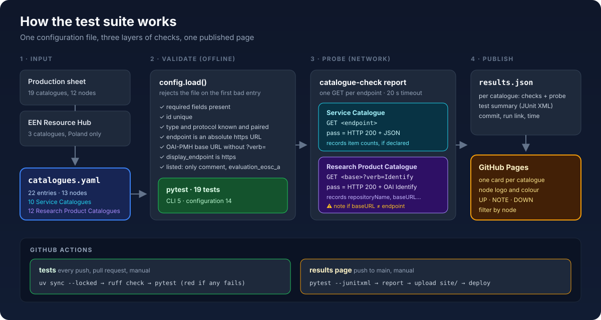
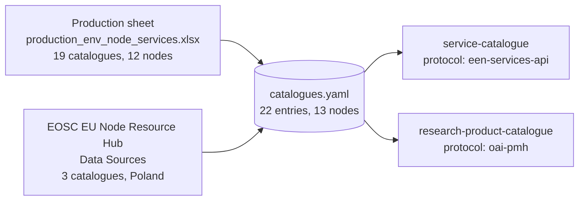
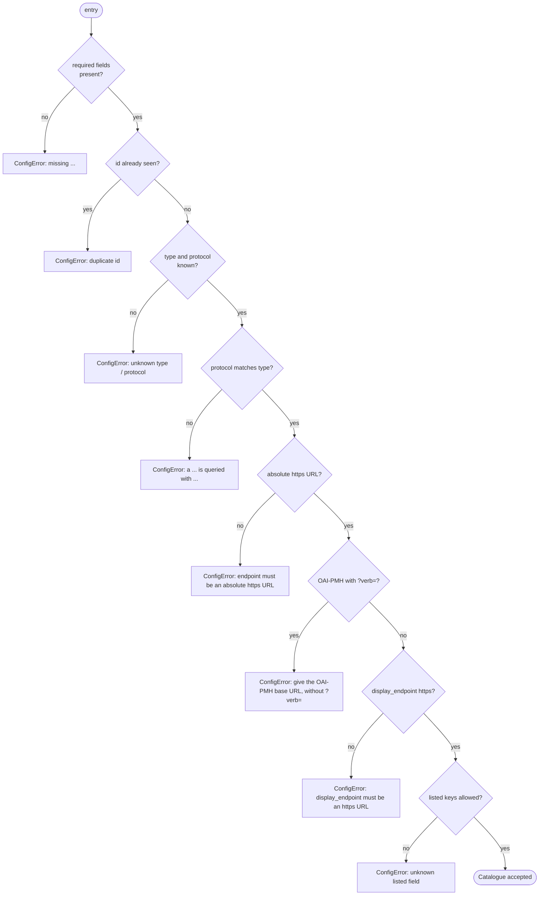
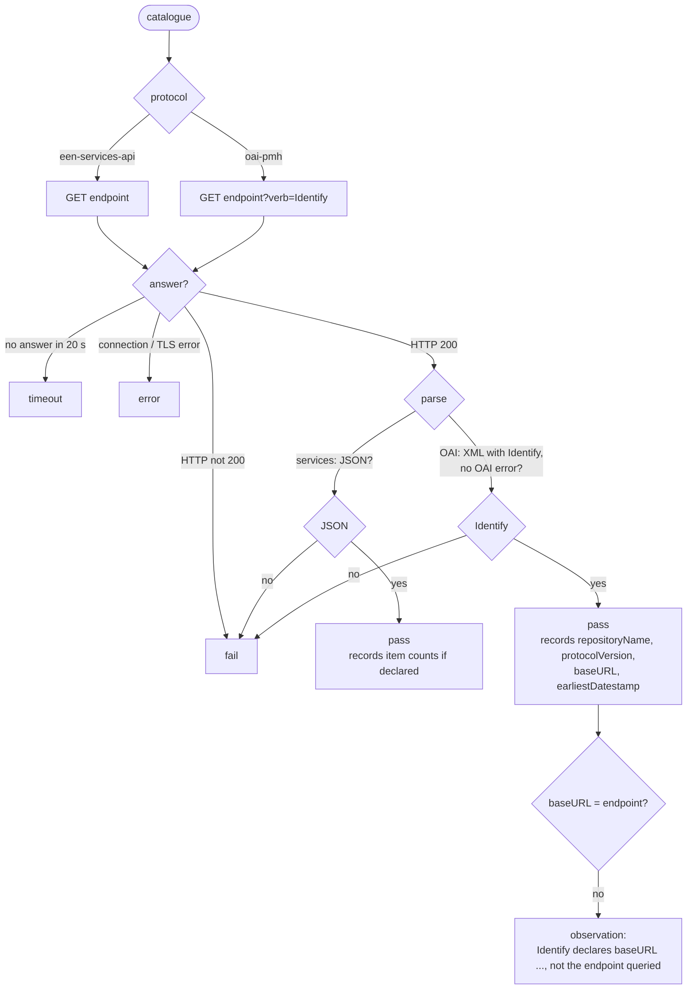
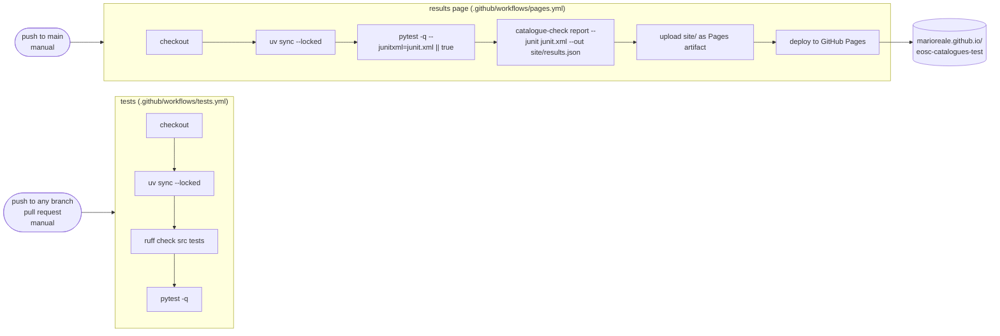
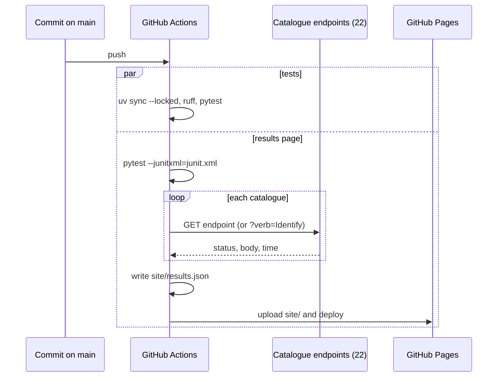

# Documentation

How `eosc-catalogues-test` works: what it reads, what it checks, how GitHub
runs it and what each test asserts.

- [Overview](#overview)
- [The configuration file](#the-configuration-file)
- [The three layers of checks](#the-three-layers-of-checks)
- [Workflows](#workflows)
- [The 19 tests](#the-19-tests)
- [What the results page shows](#what-the-results-page-shows)
- [What is not tested](#what-is-not-tested)
- [Running it locally](#running-it-locally)

## Overview



The suite has one input, `catalogues.yaml`, which lists every catalogue to test.
Three layers act on it:

| Layer | Where | Network | What it does |
|---|---|---|---|
| Validation | `src/catalogue_check/config.py` | no | Rejects a malformed file before anything else runs. |
| Test suite | `tests/` (pytest) | no | 19 tests: the committed file and the validation rules. |
| Availability probe | `src/catalogue_check/report.py` | yes | One request per endpoint, with the answer recorded. |

The probe and the test results are written to `site/results.json`. GitHub
Pages publishes them at
<https://marioreale.github.io/eosc-catalogues-test/>.

## The configuration file

`catalogues.yaml` holds 22 catalogues from 13 EOSC Nodes:

- 10 Service Catalogues, queried through the EOSC EU Node services API.
- 12 Research Product Catalogues, queried through OAI-PMH.



Each entry has these fields:

| Field | Required | Meaning |
|---|---|---|
| `id` | yes | Unique key, e.g. `eosc-pl-repod-oai`. |
| `node` | yes | Node id, the same as in `eosc-basic-compliance`'s `nodes.yaml`. |
| `name` | yes | Catalogue name as shown on the page. |
| `type` | yes | `service-catalogue` or `research-product-catalogue`. |
| `protocol` | yes | `een-services-api` or `oai-pmh`; it must match `type`. |
| `endpoint` | yes | The URL that is queried. HTTPS only. For OAI-PMH, the base URL without `?verb=`. |
| `source` | yes | Where the endpoint comes from: `production` or `resource-hub`. |
| `display_endpoint` | no | A URL shown instead of `endpoint`. Only Czechia has one, and its `note` explains why. |
| `website` | no | The catalogue's home page. |
| `note` | no | Free-text provenance; Resource Hub entries give their Hub record PID. |
| `listed` | no | The sheet's own words, quoted: `comment` and `evaluation_eosc_a` only. |

## The three layers of checks

### 1. Validation

Every command loads the file through `config.load()`. It stops at the first
bad entry with a `ConfigError`, and the CLI exits with status 2.



### 2. Test suite

pytest runs 19 tests in two files; they are described [below](#the-19-tests).
None of them uses the network.

- `tests/test_config.py` checks the committed `catalogues.yaml` and proves that
  bad entries are rejected.
- `tests/test_cli.py` runs the command-line tool.

### 3. Availability probe

`catalogue-check report` sends exactly one GET to each endpoint. It uses a
20-second timeout, follows redirects, and sends the User-Agent
`eosc-catalogues-test/<version>`.



The probe also repeats six configuration checks for each entry, so that each
card on the page shows them:

| Key | Label on the page | Passes when |
|---|---|---|
| `fields` | All required fields present | always, since loading already enforces it |
| `node` | Node is a known EOSC Node | `node` has a display name in `NODE_NAMES` |
| `protocol` | Protocol matches catalogue type | `type` and `protocol` are a valid pair |
| `https` | Endpoint uses HTTPS | `endpoint` starts with `https://` |
| `oai-base` | OAI-PMH base URL has no `?verb=` | OAI-PMH entries only |
| `source` | Endpoint taken from the production sheet | `source: production` |
| `source` | Resource Hub entry names its Hub record | `source: resource-hub`, with no `listed` and `Hub record 21.11166/` in `note` |

Each card shows one of the two `source` checks, so OAI-PMH cards show six
checks and Service Catalogue cards show five.

## Workflows

Two GitHub Actions workflows run independently:



| | tests | results page |
|---|---|---|
| File | `.github/workflows/tests.yml` | `.github/workflows/pages.yml` |
| Triggers | every push, every pull request, manual | push to `main`, manual |
| Steps | install the locked dependencies, lint with ruff, run pytest | install, run pytest with JUnit XML output, probe, build `results.json`, publish |
| Fails when | lint or any test fails | a step itself breaks; a failing test does not stop publication (`\|\| true`) |
| Uses the network | no | yes (the probe) |
| Permissions | `contents: read` | `contents: read`, `pages: write`, `id-token: write` |

A failing test turns the "tests" workflow red. The results page is still
published, and it shows the failure in its test list. The probe runs only in
"results page", so an endpoint that is down never fails CI.



## The 19 tests

### `tests/test_config.py`: the committed file and the validation rules

| # | Test | What it asserts | Why |
|---|---|---|---|
| 1 | `test_the_first_catalogues_are_configured` | There are 22 entries; 10 are Service Catalogues; there are 13 distinct nodes. | Any entry added or removed by mistake shows up as a failing count. |
| 2 | `test_ids_are_unique_and_nodes_are_known` | No `id` appears twice, and every `node` is one of the 16 node ids of `eosc-basic-compliance`. | Results from the two projects can be joined by node. |
| 3 | `test_type_and_protocol_agree` | Each entry's `protocol` is the one its `type` requires. | A Service Catalogue is never probed with OAI-PMH, and the reverse. |
| 4 | `test_endpoints_are_https_and_oai_bases_have_no_verb` | Every endpoint starts with `https://`; no OAI-PMH endpoint contains `verb=`. | The probe adds `?verb=Identify` itself; a copied request URL would break it. |
| 5 | `test_every_entry_comes_from_the_production_sheet_but_known_exceptions` | `source` is `production` for every node except the known exceptions listed in `KNOWN_EXCEPTIONS` (today only Poland, `resource-hub`). `listed` holds only `comment` and `evaluation_eosc_a`. | Provenance stays explicit; only the production sheet's two columns are quoted. |
| 6 | `test_resource_hub_entries_quote_nothing_and_name_their_record` | There are exactly 3 Resource Hub entries. None has `listed`, and each `note` cites a `Hub record 21.11166/…` PID. | The Hub has no comment column, so nothing is attributed to it, and each entry can be traced. |
| 7 | `test_a_display_endpoint_is_explained_in_the_note` | Only `eosc-cz-nmd-oai` has a `display_endpoint`. It differs from `endpoint`, and both URLs appear in the note. | Showing one URL while querying another is always disclosed. |
| 8 | `test_bad_entries_are_rejected[…queried with]` | A Service Catalogue declared with `oai-pmh` is rejected. | Checks the type/protocol rule in `config.load()`. |
| 9 | `test_bad_entries_are_rejected[…unknown type]` | A type such as `dataset-catalogue` is rejected. | Only the two catalogue types exist. |
| 10 | `test_bad_entries_are_rejected[…https URL]` | An `http://` endpoint is rejected. | HTTPS only. |
| 11 | `test_bad_entries_are_rejected[…without ?verb=]` | An OAI-PMH endpoint ending in `?verb=Identify` is rejected. | Base URLs only. |
| 12 | `test_duplicate_ids_are_rejected` | Two entries with the same `id` are rejected. | Ids are keys on the page and in the JSON. |
| 13 | `test_unknown_listed_fields_are_rejected` | `listed: {status: …}` is rejected. | Quotes are limited to the two production-sheet columns; for example, the sheet's status is not carried over. |
| 14 | `test_every_known_node_has_a_display_name` | `NODE_NAMES` in `report.py` covers exactly the 16 known nodes. | Every card can show a readable node name. |

Tests 8 to 11 are one parametrized test, `test_bad_entries_are_rejected`. Each
case writes a small invalid file to a temporary directory and expects a
`ConfigError` with the given message.

### `tests/test_cli.py`: the command-line tool

| # | Test | What it asserts | Why |
|---|---|---|---|
| 15 | `test_version` | `catalogue-check version` exits 0 and prints the package version. | The command-line tool installs and starts. |
| 16 | `test_catalogues_lists_the_configured_ones` | `catalogue-check catalogues` exits 0, lists `bbmri-eric-services`, and ends with `22 catalogue(s): 10 service, 12 research product.` | The listing command reads the committed file and counts it correctly. |
| 17 | `test_an_empty_list_is_reported` | An empty `catalogues: []` file prints `No catalogues configured yet.` and exits 0. | An empty file is reported, not treated as an error. |
| 18 | `test_a_bad_file_is_a_configuration_error` | An entry with only an `id` makes the command exit with status 2. | A malformed file stops the tool with a distinct exit code. |
| 19 | `test_report_without_probe_writes_per_catalogue_checks` | `catalogue-check report --no-probe` writes JSON with 22 catalogues. Each has a node name, no probe result, and all its configuration checks passing. | The results page's data file is built correctly, without using the network. |

On the [results page](https://marioreale.github.io/eosc-catalogues-test/),
selecting a test in the Test suite list opens these descriptions. They are kept
in `site/test-descriptions.json`.

## What the results page shows

The page reads `results.json` and shows one card per catalogue. Service
Catalogues appear in cyan, Research Product Catalogues in violet. Each card
has its node's logo and colour, and the page can be filtered by node.

| Badge | Meaning |
|---|---|
| UP | All configuration checks passed, and the probe passed with no observation. |
| UP · NOTE | The probe passed but recorded an observation, e.g. Identify declares a different `baseURL`. |
| TIMEOUT | No answer within 20 s. |
| DOWN | The probe returned `fail` (not HTTP 200, or not the expected format) or `error` (connection or TLS). |
| CONFIG FAILS | At least one configuration check failed. |
| NOT PROBED | The JSON was built with `--no-probe`. |

The header counts catalogues, nodes, endpoints that answered, and tests passed. The test list
comes from the JUnit XML of the same run.

## What is not tested

- Compliance with the EOSC EU Node services API schema or the OpenAIRE
  guidelines.
- Harvesting: no `ListRecords`, `ListSets` or paging is requested.
- Metadata quality, including DCAT/DCAT-AP.
- Authentication, rate limits, or behaviour over time; each run sends a single
  request per endpoint.

A green probe only means the endpoint was up and answered in the expected
format at the time of the run.

## Running it locally

```sh
uv sync --locked
uv run ruff check src tests
uv run pytest -q                                   # the 19 tests, offline
uv run catalogue-check catalogues                  # list and validate catalogues.yaml
uv run catalogue-check report --no-probe           # results.json without network
uv run pytest -q --junitxml=junit.xml
uv run catalogue-check report --junit junit.xml --out site/results.json
python3 -m http.server -d site 8000                # then open http://localhost:8000
```
