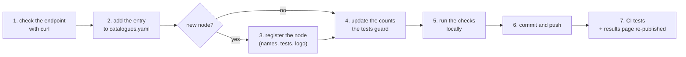

# Deployment guide

How to install `eosc-catalogues-test`, configure it, run it, add a new
catalogue (Service or Research Product), re-run the suite online and
re-publish the results.

How the suite works and what each test asserts is in the
[documentation](README.md); this guide is about doing things with it.

- [What you need](#what-you-need)
- [Install](#install)
- [Configure](#configure)
- [Run locally](#run-locally)
- [Add a new catalogue](#add-a-new-catalogue)
  - [Before you start: check the endpoint](#before-you-start-check-the-endpoint)
  - [Add a Service Catalogue](#add-a-service-catalogue)
  - [Add a Research Product Catalogue](#add-a-research-product-catalogue)
  - [When the node is new](#when-the-node-is-new)
  - [When the endpoint is not from the production sheet](#when-the-endpoint-is-not-from-the-production-sheet)
  - [Update the counts the tests guard](#update-the-counts-the-tests-guard)
  - [Check, commit and push](#check-commit-and-push)
- [Re-run the suite online and re-publish the results](#re-run-the-suite-online-and-re-publish-the-results)
- [Deploy in another repository](#deploy-in-another-repository)
- [Troubleshooting](#troubleshooting)

## What you need

| For | You need |
|---|---|
| Running it locally | Python 3.12 or newer, [uv](https://docs.astral.sh/uv/), git, network access for the probe |
| Changing the catalogues and publishing | Write access to [marioreale/eosc-catalogues-test](https://github.com/marioreale/eosc-catalogues-test) (or a pull request) |
| Running the workflow by hand from a terminal | Optional: the [GitHub CLI](https://cli.github.com/) (`gh`), logged in |

Nothing else is installed system-wide: uv creates a virtual environment in
`.venv/` with the exact versions pinned in `uv.lock`.

## Install

```bash
git clone https://github.com/marioreale/eosc-catalogues-test.git
cd eosc-catalogues-test
uv sync                              # creates .venv/ from uv.lock
uv run catalogue-check version       # prints the version: the tool is installed
uv run pytest -q                     # 19 passed
```

If uv is not installed yet: `curl -LsSf https://astral.sh/uv/install.sh | sh`
(or see the [uv installation page](https://docs.astral.sh/uv/getting-started/installation/)).

## Configure

There is one configuration file, `catalogues.yaml`, at the root of the
repository: one entry per catalogue endpoint. Its header explains every field;
the table below is the short version.

| Field | Required | What to put |
|---|---|---|
| `id` | yes | Stable, unique identifier: `<node>-<short name>-<services\|oai>`, for example `eudat-b2find-oai` |
| `node` | yes | The node id, as in eosc-basic-compliance's `nodes.yaml` (for example `eosc-it`) |
| `name` | yes | The name the catalogue gives itself |
| `type` | yes | `service-catalogue` or `research-product-catalogue` |
| `protocol` | yes | `een-services-api` for a Service Catalogue, `oai-pmh` for a Research Product Catalogue |
| `endpoint` | yes | The `https://` URL queried. For OAI-PMH, the base URL without `?verb=` |
| `source` | yes | `production` (the production sheet), or an agreed exception such as `resource-hub` |
| `website` | no | The human-facing catalogue site |
| `display_endpoint` | no | The URL to show instead of `endpoint`, when they differ; explain it in `note` |
| `listed` | no | What the production sheet says, quoted: `comment` and/or `evaluation_eosc_a` |
| `note` | no | Anything a reader needs to know before trusting the entry |

The file is validated every time it is loaded; a mistake (missing field,
duplicate id, wrong protocol for the type, `http://`, `?verb=` in an OAI-PMH
base URL) stops the tool with a message naming the entry.

The other settings live in code and rarely change:

| Setting | Where |
|---|---|
| Known nodes and their display names | `NODE_NAMES` in `src/catalogue_check/report.py`, `KNOWN_NODES` in `tests/test_config.py` |
| Probe timeout (20 s) | `TIMEOUT` in `src/catalogue_check/report.py` |
| Node logos | `site/logos/<node>.png` and the `LOGOS` list in `site/app.js` |
| Published page addresses | `PAGE_URL` and `PREVIEW_URL` in `src/catalogue_check/report.py` |

## Run locally

```bash
uv run catalogue-check catalogues          # list and validate catalogues.yaml
uv run pytest -q --junitxml=junit.xml      # the 19 tests, no network
uv run catalogue-check report --junit junit.xml \
    --out site/results.json --markdown results/README.md
                                           # probe every endpoint once (network)
uv run catalogue-check bundle              # results/index.html, self-contained
python3 -m http.server -d site 8000        # open http://localhost:8000
```

`catalogue-check report --no-probe` skips the network and only evaluates the
configuration checks. The files written locally (`site/results.json`,
`junit.xml`, `results/`) are for looking at; the published ones are produced
by the workflow, so there is no need to commit them.

## Add a new catalogue

The steps, in short:



### Before you start: check the endpoint

Send by hand the same request the probe will send. The answer must be HTTP 200
in the expected format.

Service Catalogue (EOSC EU Node services API), expected: JSON.

```bash
curl -sS -o /dev/null -w "%{http_code} %{content_type}\n" https://example-node.eu/services
curl -sS https://example-node.eu/services | head -c 400; echo
```

Research Product Catalogue (OAI-PMH), expected: XML with an `<Identify>`
element, and ideally a `<baseURL>` equal to the endpoint you will configure.

```bash
curl -sS "https://repository.example.eu/oai?verb=Identify"
```

If the `baseURL` in the answer differs from the URL you queried, the card will
show a "note"; that is allowed, but say why in the entry's `note` if you know.

### Add a Service Catalogue

Add the entry under the `services` block of `catalogues.yaml` (after the
`# --- services` comment line):

```yaml
  - id: eosc-de-services
    node: eosc-de
    name: EOSC Node Germany Service Catalogue
    type: service-catalogue
    protocol: een-services-api
    endpoint: https://catalogue.example.de/services
    website: https://catalogue.example.de
    source: production
```

For a Service Catalogue:

- `type` is `service-catalogue` and `protocol` is `een-services-api`; the
  validation rejects any other pairing;
- `endpoint` is the URL that answers `GET` with JSON, the one registered in the
  production sheet's "Service Catalogue registered" column (tab "Services");
- the production sheet has no comment columns for services, so there is no
  `listed`.

On the results page it gets 5 configuration checks and is probed with `GET`.

### Add a Research Product Catalogue

Add the entry under the `research products` block of `catalogues.yaml`
(after the `# --- research products` comment line):

```yaml
  - id: eosc-de-example-oai
    node: eosc-de
    name: Example Research Data Repository
    type: research-product-catalogue
    protocol: oai-pmh
    endpoint: https://repository.example.de/oai
    website: https://repository.example.de
    listed: {comment: Improvement requested}
    source: production
```

For a Research Product Catalogue:

- `type` is `research-product-catalogue` and `protocol` is `oai-pmh`;
- `endpoint` is the OAI-PMH base URL, without `?verb=` (the probe adds
  `?verb=Identify`), as in the production sheet's "Research Product Catalogue
  registered" column (tab "Research product catalogues");
- `listed` quotes, word for word, what the sheet says in its "Comments"
  (`comment`) and "Evaluation / EOSC-A" (`evaluation_eosc_a`) columns; leave
  it out when both are empty;
- a sheet row that is a web page, not an OAI-PMH endpoint, is not added (see
  the header of `catalogues.yaml` for the two rows left out).

On the results page it gets 6 configuration checks (one more: base URL
without `?verb=`) and is probed with `?verb=Identify`.

If the endpoint to query differs from the address to show (as for Czechia),
add `display_endpoint` and name both URLs in `note`. The test
`test_a_display_endpoint_is_explained_in_the_note` lists the entries allowed
to do this (`["eosc-cz-nmd-oai"]`); add the new `id` to that list.

### When the node is new

If the catalogue belongs to a node with no catalogue yet, register the node:

1. `src/catalogue_check/report.py`: add `"<node id>": "<display name>"` to
   `NODE_NAMES`. Without it, the "Node is a known EOSC Node" check fails on
   the card.
2. `tests/test_config.py`: add the node id to `KNOWN_NODES`, if it is not
   there yet. The 16 nodes of eosc-basic-compliance are already listed.
3. Logo (optional): add `site/logos/<node id>.png` (wide PNG, transparent or
   white background, about 680 × 100 px like the others; it is shown 30 px
   tall in a white box), and add the node id to the `LOGOS` list at the top of
   `site/app.js`. Without a logo, the card shows the node name instead.

### When the endpoint is not from the production sheet

The rule is that every endpoint comes from the production sheet
(`source: production`). An exception has to be agreed and recorded:

1. set `source:` to where the endpoint comes from, for example `resource-hub`;
2. add the node to `KNOWN_EXCEPTIONS` in `tests/test_config.py`
   (`{"eosc-pl": "resource-hub"}` today), so the test accepts it;
3. for `resource-hub`, write the Hub record PID in `note`
   (`Hub record 21.11166/...`) and leave `listed` out: the Hub has no comment
   column. The configuration check and the test
   `test_resource_hub_entries_quote_nothing_and_name_their_record` require
   both; that test also counts the Hub entries (3 today), so update the count.

### Update the counts the tests guard

Three tests pin the size of `catalogues.yaml`, so that an entry added or
removed by mistake is noticed. After a deliberate change they fail until the
numbers are updated:

| File | What to change |
|---|---|
| `tests/test_config.py`, `test_the_first_catalogues_are_configured` | number of entries, of Service Catalogues, of distinct nodes |
| `tests/test_cli.py`, `test_catalogues_lists_the_configured_ones` | the summary line, `"N catalogue(s): S service, R research product."` |
| `tests/test_cli.py`, `test_report_without_probe_writes_per_catalogue_checks` | number of catalogues in the JSON |

Then update the same numbers where they are described:

- `site/test-descriptions.json` (pop-ups of tests 1, 16 and 19);
- `docs/README.md` (configuration section, diagrams, "The 19 tests");
- `docs/img/overview.svg` ("22 entries · 13 nodes");
- `README.md` ("Status": the counts and the table of nodes and catalogues).

With the current numbers, this lists every place to change:

```bash
git grep -n -E "\b22\b|13 nodes|10 service|12 research" -- . ':!uv.lock' ':!*.png' ':!*.css' ':!results/'
```

### Check, commit and push

```bash
uv run catalogue-check catalogues                # the new entry is listed, the totals are right
uv run ruff check src tests
uv run pytest -q                                 # 19 passed
uv run catalogue-check report --out /tmp/r.json  # probe: look at the new entry
python3 -c "import json; [print(r['id'], r['probe']['outcome'], r['probe']['summary']) for r in json.load(open('/tmp/r.json'))['catalogues'] if r['id'] == 'eosc-de-services']"
git pull --rebase                                # take the workflow's latest results/ commit
git add catalogues.yaml tests/ src/ site/ docs/ README.md
git commit -m "Catalogues: add <node> <catalogue>"
git push
```

A failed probe does not stop anything: the catalogue is published with a red
card. Only configuration mistakes and failing tests turn CI red.

## Re-run the suite online and re-publish the results

Two workflows run on GitHub Actions:

| Workflow | Runs when | Does |
|---|---|---|
| `tests` | every push and pull request, or by hand | ruff and the 19 tests; goes red if one fails |
| `results page` | every push to `main`, or by hand | tests, probe of every endpoint, results page on GitHub Pages, self-contained copy committed to `results/` |

So **a push to `main` re-runs everything and re-publishes the results**. To
re-run without changing anything, for example to probe the endpoints again:

From the browser:

1. open [Actions → results page](https://github.com/marioreale/eosc-catalogues-test/actions/workflows/pages.yml);
2. click **Run workflow**, keep the branch `main`, click **Run workflow**;
3. wait for the run to finish (about a minute).

From a terminal:

```bash
gh workflow run pages.yml --ref main -R marioreale/eosc-catalogues-test
gh run watch -R marioreale/eosc-catalogues-test   # pick the run just started
```

To re-run only the tests: the same, with the `tests` workflow (`tests.yml`).

When the run is green, the results are re-published in two places:

- the results page, <https://marioreale.github.io/eosc-catalogues-test/>; the
  "generated" date and the commit at the bottom show which run it comes from;
- [`results/`](../results/) in the repository, updated by a commit from
  `github-actions[bot]` ("results: copy of the results page from ..."); its
  README links the [browsable copy of the page](https://htmlpreview.github.io/?https://github.com/marioreale/eosc-catalogues-test/blob/main/results/index.html).

Because the workflow commits to `main`, run `git pull` before your next change.

## Deploy in another repository

To run the suite in a fork or a copy of the repository:

1. **Pages:** Settings → Pages → Build and deployment → Source: **GitHub
   Actions**.
2. **Workflow permissions:** the `results page` workflow declares the
   permissions it needs (`contents: write`, `pages: write`, `id-token: write`).
   If the organisation restricts the workflow token, allow read and write
   under Settings → Actions → General → Workflow permissions. If `main` is
   protected against direct pushes, allow `github-actions[bot]` or the copy to
   `results/` fails.
3. **Addresses:** change `PAGE_URL` and `PREVIEW_URL` in
   `src/catalogue_check/report.py`, the repository and documentation links in
   `site/index.html` (pop-ups and footer), and the links in `README.md` and
   `docs/`.
4. Push to `main`, or run the `results page` workflow by hand. The first run
   creates the GitHub Pages site and fills `results/`.

## Troubleshooting

| Symptom | Cause and fix |
|---|---|
| `catalogue-check` stops with `catalogues.yaml: entry N: ...` | The entry is malformed; the message says what (missing field, wrong protocol, `http://`, `?verb=`). |
| `test_the_first_catalogues_are_configured` (or the two CLI tests) fails after adding an entry | Expected: update the counts, see [above](#update-the-counts-the-tests-guard). |
| A card shows "Node is a known EOSC Node" failed | The node is missing from `NODE_NAMES` in `report.py`. |
| The card shows the node name instead of a logo | No `site/logos/<node>.png`, or the node is missing from `LOGOS` in `site/app.js`. |
| A red card with `HTTP 404`, `not with JSON` or `not with XML` | The endpoint answered, but not as expected: check the URL with curl. |
| An amber card with a note on `baseURL` | The Identify answer declares another base URL; record what you know in `note`. |
| `git push` rejected (non-fast-forward) | The workflow committed `results/` meanwhile: `git pull --rebase`, then push. |
| The page still shows the old results | Wait for the `results page` run to finish; GitHub Pages can take a minute more. Reload the page. |
